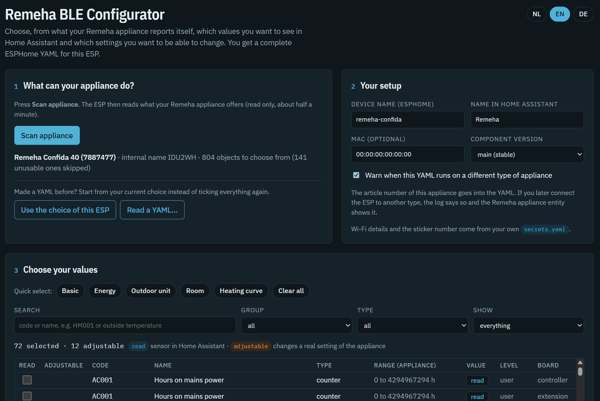
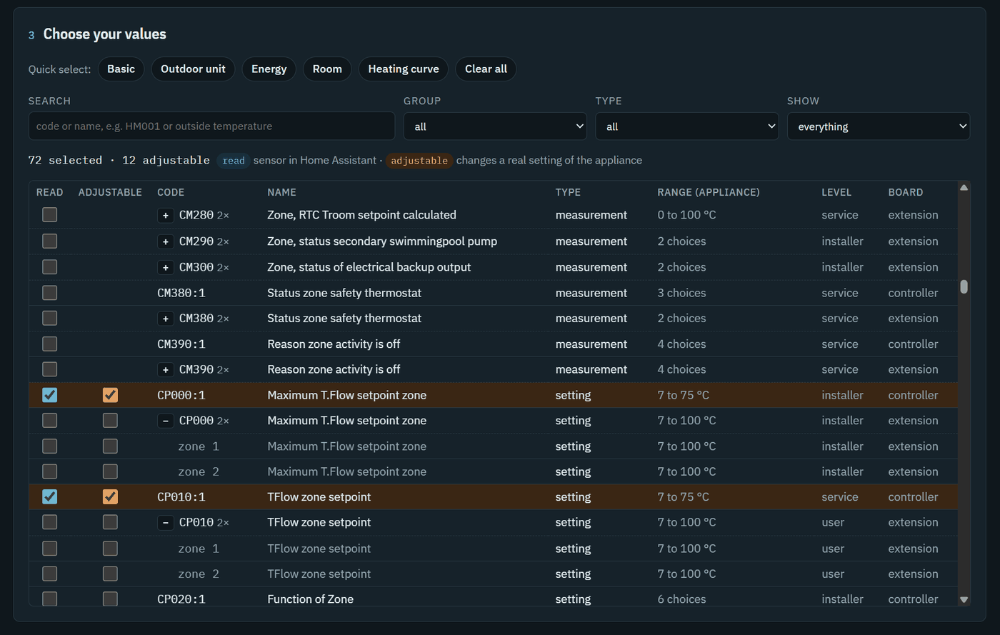
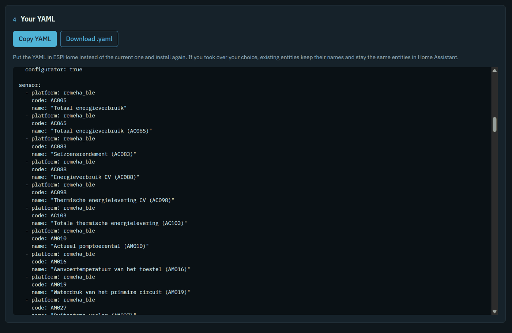

[English](README.md) | [Nederlands](README.nl.md) | **Deutsch**

# ESPHome Remeha BLE

Lies und steuere eine **Remeha**-Wärmepumpe oder einen Remeha-Kessel aus **Home
Assistant** über **Bluetooth**, mit einem ESP32 und ESPHome. Kein Gateway, keine Cloud:
der ESP spricht das eigene Bluetooth-Protokoll des Geräts und gibt Temperaturen, Drücke,
Durchfluss, Leistung, COP, Zähler und Status an Home Assistant weiter. Einstellungen wie
die Heizkurve lassen sich ebenfalls ändern.

Was du siehst, bestimmst du selbst: der ESP scannt, was **dein** Gerät kann, und eine
eingebaute Webseite, der **Konfigurator**, macht aus deiner Auswahl eine komplette
ESPHome-YAML.

- Funktioniert mit beiden Bluetooth-Wegen von Remeha: dem **eingebauten
  Bluetooth**-Modul (meldet sich als `EHC-...`, z. B. Confida 40) und dem **GTW-IoT
  Home-Hub** (meldet sich als `GTW-IOT_...`, z. B. Confida 10). Die Komponente erkennt
  den Weg selbst.
- Getestet mit einer Remeha Confida 40. Andere Remeha-Geräte mit demselben Protokoll
  (EHC-Regler) sollten ebenfalls funktionieren; berichte deine Erfahrung gern in einem
  Issue.
- Nutzung auf eigene Gefahr. Dieses Projekt steht in keiner Verbindung zu Remeha.



## Was du brauchst

- Ein **ESP32**-Board (Standard `esp32dev`; passe das Board in der YAML an, wenn du ein
  anderes nutzt). Ein ESP8266 hat kein Bluetooth LE und funktioniert nicht.
- **ESPHome** 2026.10 oder neuer (eigenständig oder als Home-Assistant-Add-on).
- Für das eingebaute Bluetooth: die **6-stellige Nummer auf dem BLE-Aufkleber** deines
  Geräts (der Kopplungs-Passkey). Der GTW-IoT-Hub braucht keine Nummer.

## Schnellstart

1. **Secrets.** Trage in die `secrets.yaml` deines ESPHome ein (siehe
   [`secrets.yaml.example`](secrets.yaml.example)):
   ```yaml
   wifi_ssid: "DeinWLAN"
   wifi_password: "DeinWLANPasswort"
   remeha_bt_key: "012345"   # Aufklebernummer, in Anführungszeichen; GTW-IoT: "000000"
   ```
   Lass die Anführungszeichen stehen: ohne sie liest YAML eine Zahl mit führender Null
   als Oktalzahl.
2. **Erstes Flashen.** Lege in ESPHome ein neues Gerät mit dem Inhalt von
   [`remeha-start.yaml`](remeha-start.yaml) an und installiere es. Die Komponente wird
   automatisch von GitHub geladen. Der ESP findet das Gerät selbst, koppelt und zeigt
   eine Grundauswahl an Werten.
   GTW-IoT: drücke kurz die Taste am Hub, damit er eine Verbindung annimmt.
3. **Konfigurator.** Öffne `http://<esp-ip>/remeha` im Browser und drücke
   **Gerät scannen**. In etwa einer halben Minute liest der ESP, welche Objekte dein
   Gerät hat, mit den Grenzen, die das Gerät selbst angibt.
4. **Auswählen und flashen.** Kreuze an, was du lesen und was du ändern möchtest,
   kopiere die YAML, ersetze damit die Start-YAML in ESPHome und installiere erneut.

### Du kommst von v1.x (`remeha_confida`)?

Version 2.0 hat die Komponente in `remeha_ble` umbenannt. Der schnellste Weg: flashe die
neue Version mit der Start-YAML, öffne den Konfigurator, wähle *YAML einlesen* und füge
deine alte YAML ein. Deine Auswahl und die Namen deiner Entitäten werden übernommen. Von
Hand: siehe das [CHANGELOG](CHANGELOG.md).

## Der Konfigurator



Die Seite unter `http://<esp-ip>/remeha` kommt vom ESP selbst.

- **Gerät scannen** liest die Menübeschreibung des Geräts (Objekt 0x502B): jedes
  Objekt, das das Gerät anbietet, mit Minimum, Maximum, Schrittweite und Zugriffsebene.
  Nur lesen, es wird nichts geschrieben.
- **Lesen** bringt einen Wert als Sensor in Home Assistant. **Einstellbar** (orange)
  fügt ein Bedienelement hinzu, das eine echte Einstellung des Geräts ändert; das geht
  nur bei schreibbaren Einstellungen.
- Mit der **Schnellauswahl** wählst du eine ganze Gruppe: Basis, Energie, Außeneinheit,
  Raum, Heizkurve. Sie wurden an einer Wärmepumpe erstellt und kreuzen nur an, was dein
  Gerät hat.
- Objekte mit mehreren Elementen (pro Heizkreis, pro Aktivität, pro Erzeuger) stehen in
  einer Zeile mit einem **+**, um die Elemente anzuzeigen (siehe *Zeilen mit einem +* unten).
- Mit der Schaltfläche in der Spalte **Wert** liest du den aktuellen Wert dieses Objekts
  einmal aus. So siehst du vor dem Ankreuzen, ob er auf deinem Gerät etwas Sinnvolles
  liefert.
- **Suchen und filtern** nach Code, Name, Gruppe, Art und Ebene.
- **Mit der aktuellen Auswahl beginnen:** *Auswahl dieses ESP übernehmen* kreuzt an,
  was die Firmware jetzt ausliest; *YAML einlesen* übernimmt die
  remeha_ble-Entitäten aus einer eingefügten YAML, einschließlich selbst vergebener
  Namen.
- **Sprachen:** Deutsch, Englisch und Niederländisch. Die Sprache bestimmt auch die
  Entitätsnamen und Auswahltexte in der erzeugten YAML.
- **Warnen, wenn diese YAML auf einem anderen Gerätetyp läuft:** schreibt die
  Artikelnummer des gescannten Geräts in die YAML. Schließt du den ESP später an einen
  anderen Typ an, meldet das Log das und die Entität *Remeha Gerät* zeigt es an.

### Zeilen mit einem +

Manche Objekte sind kein einzelner Wert, sondern eine kurze Reihe von Werten unter
einem Code, zum Beispiel einer pro Heizkreis. Ein solches Objekt bekommt eine Zeile mit
**+** und der Anzahl der Elemente (`CP000 2×`). Drücke **+**, um die Elemente darunter
anzuzeigen, jedes mit einer Bezeichnung:

- **Heizkreis 1, Heizkreis 2:** Heizkreis-Objekte (Codes, die mit C beginnen, etwa die
  Heizkurve und die Raumtemperaturen).
- **Aktivität 1 bis 6:** die Raumsollwerte pro Aktivität des Zeitprogramms (CP080,
  CP140); bei mehreren Heizkreisen siehst du *Heizkreis 2, Aktivität 1* usw.
- **Erzeuger 1, Erzeuger 2:** Energiezähler pro Erzeuger. Erzeuger 1 ist die
  Wärmepumpe; Erzeuger 2 ist sehr wahrscheinlich die Zusatzheizung.

Die Kästchen in der Zeile mit **+** wählen alle Elemente auf einmal aus oder ab; ein
halb gefülltes Kästchen bedeutet, dass nur ein Teil ausgewählt ist. Du kannst auch
einzelne Elemente ankreuzen. Hat eine Platine nur ein Element eines Objekts, steht es
als normale Zeile mit der Elementnummer, etwa `CP000:1`.

Derselbe Code kann in zwei Zeilen mit unterschiedlicher **Platine** stehen: der
*Regler* (Knoten 1) und die *Erweiterungsplatine* (Knoten 4) haben jeweils eine eigene
Kopie vieler Objekte. Für die meisten Anlagen ist die des Reglers die richtige.

### Objekte außerhalb des Menüs

Der Scan zeigt, was das Gerät in seiner eigenen Menübeschreibung angibt: das Menü
seines Displays. Die Remeha-App zeigt mehr, zum Beispiel die Verdampfer- und
Kondensatortemperatur des Außengeräts. Fast alle diese Objekte stehen im Codebuch,
und du bekommst sie auf zwei Wegen in den Konfigurator:

- **+ Aus dem Codebuch** öffnet eine Suche nach Code, Index oder Name. **Lesen** zeigt
  sofort, ob das Objekt auf deinem Gerät existiert; **Hinzufügen** setzt es als Zeile
  mit *nicht im Menü* in die Tabelle. Ein Code aus der Remeha-App, der nicht im
  Codebuch steht, etwa `AC089` oder `CP083`, ist meist ein Element einer Liste
  (`AC088` Element 2, `CP080` Aktivität 4); die Suche sagt das.
- **Außerhalb des Menüs suchen** lässt den ESP jedes Codebuch-Objekt probieren, das
  nicht im Menü steht (nur lesen). Schritt 1 fragt die Messwerte und Zähler in Gruppen
  von 32 ab und dauert etwa eine Minute; Schritt 2 liest die übrigen
  Einstellungen einzeln und dauert einige Minuten. Solange das läuft, pausiert das
  normale Auslesen. Alles, was einen Wert liefert, kommt als *nicht im Menü* dazu;
  wähle *Anzeigen: nur nicht im Menü*, um sie zu sehen.

Ein Objekt außerhalb des Menüs hat keine Grenzen vom Gerät: eine einstellbare Entität
dafür kennt kein Minimum oder Maximum vom Gerät, lege sie also nur an, wenn du weißt,
was die Einstellung macht.

Der Konfigurator wird mit `configurator: true` unter `remeha_ble:` eingeschaltet und
braucht `web_server:`. Er belegt etwa 150 kB Flash; setze ihn auf `false`, wenn du
fertig bist und den Platz brauchst.

## Die YAML in Kürze

Der Konfigurator schreibt die ganze Datei, aber es hilft zu wissen, was darin steht.



```yaml
remeha_ble:
  id: remeha
  ble_client_id: remeha_client
  passkey: !secret remeha_bt_key   # eingebautes Bluetooth; beim GTW-IoT ignoriert
  appliance:
    name: "Remeha Gerät"           # erkanntes Gerät (Artikelnummer und Name)
  configurator: true               # Seite unter http://<esp-ip>/remeha

sensor:
  - platform: remeha_ble
    code: HM001                    # Vorlauftemperatur Wärmepumpe
  - platform: remeha_ble
    code: HM116
    name: "Hochdruck"              # was du selbst angibst, hat Vorrang

number:
  - platform: remeha_ble
    code: CP230                    # Steilheit der Heizkurve (ändert das Gerät!)
```

- **`code:`** ist der Gerätecode aus dem Codebuch (zum Beispiel `HM001`). Index,
  Subindex, Datentyp, Skalierung, Einheit, Home-Assistant-Klassen und ein Name werden
  automatisch eingetragen.
- **Welche Plattform?** `sensor` für Zahlen, `text_sensor` für eine Auswahlliste als
  Text, `binary_sensor` für an/aus, `number` für eine einstellbare Zahl, `select` für
  eine einstellbare Auswahlliste, `switch` für einen einstellbaren An/Aus-Wert. ESPHome
  meldet es, wenn eine Plattform nicht zum Objekt passt.
- **`subindex:`** wählt ein Element eines Array-Objekts (Heizkreis, Erzeuger);
  **`node:`** eine andere Platine im Gerät (1 = Regler, 4 = Erweiterungsplatine).
- **Grenzen aus dem Gerät:** eine `number` übernimmt das echte Minimum, Maximum und die
  Schrittweite des Geräts und lehnt Werte außerhalb ab; ein `select` lehnt Auswahlen ab,
  die das Gerät nicht erlaubt. Mit `device_limits: false` an einer `number` schaltest du
  das ab.
- **Objekte ohne Code** fügst du mit `index:`, `subindex:` und `value_type:` hinzu;
  siehe das Codebuch in [`data/`](data/README.md).

### Verbindungsoptionen

| Option | Bedeutung |
|---|---|
| `passkey` | die Aufklebernummer (eingebautes Bluetooth) |
| `connection` | `auto` (Standard): Weg am Namen erkennen; `paired` oder `plain`, um ihn festzulegen |
| `device_name_prefix` | nur mit einem Gerät verbinden, dessen Name so beginnt (Standard: `EHC-` oder `GTW-IOT`) |
| `ble_mac` (Substitution) | `00:00:00:00:00:00` findet das Gerät automatisch; bei mehreren Geräten in Reichweite die MAC aus dem Log eintragen (`BLE gezien: ...`) |
| `expected_article_number` | warnen, wenn das verbundene Gerät ein anderer Typ ist |
| `update_interval` | wie oft die Werte gelesen werden (Standard 30 s) |

Diagnose-Entitäten: `write_result` (letzter Schreibvorgang, angenommen oder mit Grund
abgelehnt), `reconnect_reason` und `reconnect_count`.

### Der Schalter "Remeha Auslesen"

Es ist immer nur **eine** Bluetooth-Verbindung zum Gerät möglich. Schalte *Remeha
Auslesen* aus, damit der ESP die Verbindung freigibt und nicht neu verbindet, sodass
sich eine Handy-App oder ein Service-Tool verbinden kann. Schalte ihn wieder ein, um
weiterzumachen. Nach einem Neustart ist er an.

## Einstellungen ändern: Vorsicht

Eine einstellbare Entität (`number`, `select`, `switch`) ändert eine **echte
Einstellung** des Geräts. Nutze sie nur, wenn du weißt, was die Einstellung bewirkt.
Nach jedem Schreiben liest der ESP den Wert zurück, sodass die Entität zeigt, was
wirklich im Gerät steht. Einen abgelehnten Schreibvorgang siehst du mit dem Grund bei
der Entität *letztes Schreibergebnis*.

## Fehlersuche

- **Koppeln schlägt fehl / "auth fail":** fast immer ein falscher Passkey. Prüfe
  `remeha_bt_key` und die Anführungszeichen. Im Start-Log steht `passkey ****xx` mit den
  letzten zwei Ziffern.
- **Nach einem falschen Passkey schlägt es weiter fehl:** das Gerät sperrt neue Versuche
  für 60 s. Die Komponente wartet jedes Mal länger (90 s, 3, 5, 10 min). Etwas Geduld
  statt neu zu starten.
- **GTW-IoT wird nicht gefunden:** drücke kurz die Taste am Hub und achte darauf, dass
  die Remeha-App nicht gleichzeitig verbunden ist. Das Log zeigt
  `route herkend aan de naam: GTW-IoT (zonder koppelen)`, wenn er erkannt wurde.
- **Ein Handy kann sich nicht verbinden:** der ESP ist verbunden. Schalte *Remeha
  Auslesen* aus.
- **Eingebautes Bluetooth merkt sich 3 Geräte:** koppelst du ein viertes, vergisst es
  das älteste.
- **Ein Wert bleibt leer:** nicht jedes Objekt gibt es auf jedem Gerät. Objekte, die
  das Gerät nicht kennt, werden einmal im Log gemeldet und danach nicht mehr abgefragt.

Die Komponente schreibt ihr Log auf Niederländisch; die Meldungen sind kurz und gut
durchsuchbar.

## Wie es funktioniert

Koppeln, die beiden Challenge/Response-Gates, das Frame-Format und die Lese- und
Schreibvorgänge sind in [`docs/readme.md`](docs/readme.md) beschrieben
(Niederländisch). Das Codebuch mit allen Objekten, Auswahllisten und Fehlercodes liegt
in [`data/`](data/README.md).

## Ordnerstruktur

```
remeha-start.yaml           erstes Flashen: verbindet, Grundauswahl, Konfigurator an
components/remeha_ble/  die ESPHome External Component
data/                       Codebuch: Objekte, Auswahllisten, Fehlercodes, Übersetzungen
docs/readme.md              Beschreibung des Protokolls
tools/                      Skripte, die codebook.json und die Konfigurator-Seite bauen
secrets.yaml.example        Beispiel-secrets.yaml
CHANGELOG.md                Änderungen pro Version
LICENSE                     MIT-Lizenz
```

## Änderungen

Siehe [CHANGELOG.md](CHANGELOG.md).

## Lizenz

Der Code steht unter der [MIT-Lizenz](LICENSE). Das Codebuch in
[`data/`](data/README.md) ist ein Nachschlagewerk ohne Gewähr; es ist nicht offiziell
und weder von Remeha erstellt noch genehmigt. Markennamen gehören ihren Inhabern.
