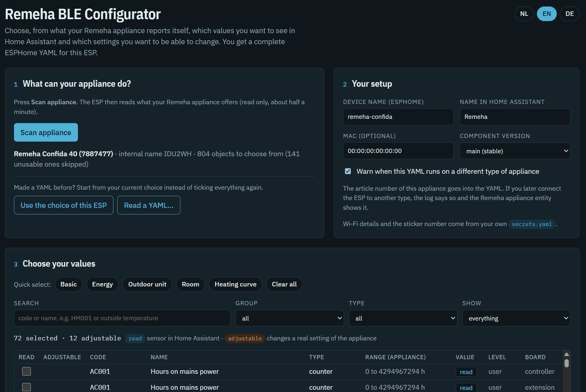
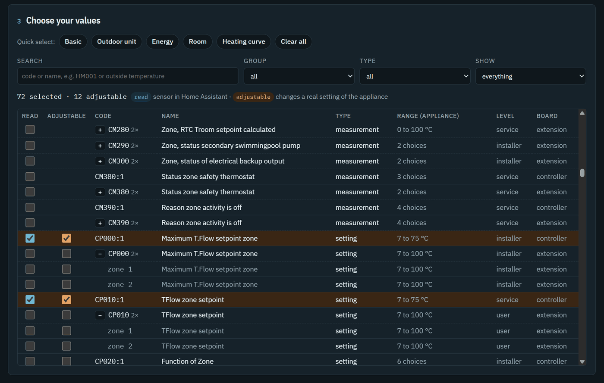
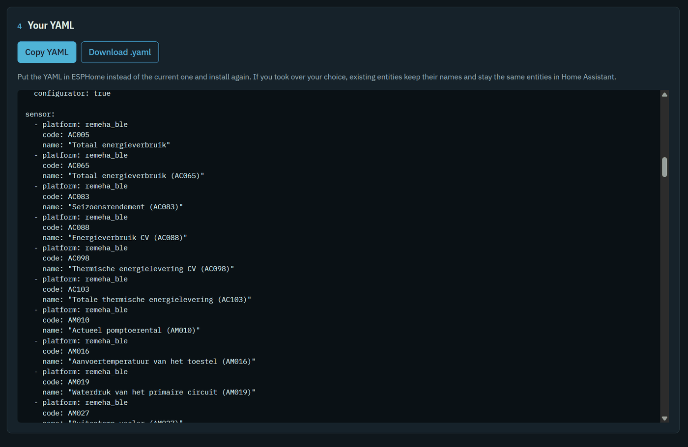

**English** | [Nederlands](README.nl.md) | [Deutsch](README.de.md)

# ESPHome Remeha BLE

Read and control a **Remeha** heat pump or boiler from **Home Assistant** over
**Bluetooth**, with an ESP32 running ESPHome. No gateway, no cloud: the ESP talks the
appliance's own Bluetooth protocol and passes temperatures, pressures, flow, power, COP,
counters and status to Home Assistant. Settings such as the heating curve can be changed
as well.

What you see is up to you: the ESP scans what **your** appliance offers and a built-in
web page, the **configurator**, turns your choice into a complete ESPHome YAML.

- Works with both Bluetooth routes Remeha uses: the **built-in Bluetooth** module
  (advertises as `EHC-...`, e.g. Confida 40) and the **GTW-IoT home hub** (advertises as
  `GTW-IOT_...`, e.g. Confida 10). The component recognises the route by itself.
- Tested on a Remeha Confida 40. Other Remeha appliances that speak the same protocol
  (EHC controller) are expected to work; please report your experience in an issue.
- Use at your own risk. This project is not affiliated with Remeha.



## What you need

- An **ESP32** board (default `esp32dev`; change the board in the YAML if you use
  another one). An ESP8266 has no Bluetooth LE and does not work.
- **ESPHome** 2026.10 or newer (standalone or the Home Assistant add-on).
- For the built-in Bluetooth: the **6-digit number on the BLE sticker** of your appliance
  (the pairing passkey). The GTW-IoT hub needs no number.

## Quick start

1. **Secrets.** Add to the `secrets.yaml` of your ESPHome (see
   [`secrets.yaml.example`](secrets.yaml.example)):
   ```yaml
   wifi_ssid: "YourWifi"
   wifi_password: "YourWifiPassword"
   remeha_bt_key: "012345"   # sticker number, in quotes; GTW-IoT: "000000"
   ```
   Keep the quotes: without them YAML reads a number with a leading zero as octal.
2. **First flash.** Create a new device in ESPHome with the contents of
   [`remeha-start.yaml`](remeha-start.yaml) and install it. The component is fetched
   from GitHub automatically. The ESP finds the appliance by itself, pairs and shows a
   basic set of values.
   GTW-IoT: press the button on the hub briefly so it accepts a connection.
3. **Configurator.** Open `http://<esp-ip>/remeha` in your browser and press
   **Scan appliance**. Within about half a minute the ESP reads which objects your
   appliance has, including the limits the appliance itself reports.
4. **Choose and flash.** Tick what you want to read and what you want to be able to
   change, copy the YAML, replace the start YAML in ESPHome with it and install again.

### Coming from v1.x (`remeha_confida`)?

Version 2.0 renamed the component to `remeha_ble`. The quickest way over: flash the
new version with the start YAML, open the configurator, choose *Read a YAML* and paste
your old YAML. Your choice and the names of your entities are taken over. Doing it by
hand: see the [CHANGELOG](CHANGELOG.md).

## The configurator



The page at `http://<esp-ip>/remeha` is served by the ESP itself.

- **Scan appliance** reads the menu description of the appliance (object 0x502B): every
  object it offers, with minimum, maximum, step and access level. Read only, nothing is
  written.
- **Read** puts a value in Home Assistant as a sensor. **Adjustable** (orange) adds a
  control that changes a real setting of the appliance; it is only offered for settings
  that can be written.
- **Quick select** buttons tick a group at once: Basic, Energy, Outdoor unit, Room,
  Heating curve. They were made on a heat pump and only tick what your appliance has.
- Objects with several elements (per zone, per activity, per producer) are shown on one
  row with a **+** to show the elements (see *Rows with a +* below).
- The button in the **Value** column reads the current value of that object once, so
  you can see whether it means something on your appliance before you tick it.
- **Search and filters** by code, name, group, type and level.
- **Start from your current choice:** *Use the choice of this ESP* ticks what the
  firmware reads now; *Read a YAML* takes over the remeha_ble entities from a YAML
  you paste, including names you gave yourself.
- **Languages:** English, Dutch and German. The language also sets the entity names and
  choice texts in the YAML you get.
- **Warn when this YAML runs on a different type of appliance:** puts the article number
  of the scanned appliance in the YAML. If you later connect the ESP to another type,
  the log says so and the *Remeha appliance* entity shows it.

### Rows with a +

Some objects are not one value but a short list of values under one code, for example
one per zone. Such an object gets one row with **+** and the number of elements
(`CP000 2×`). Press **+** to show the elements underneath, each with a label:

- **zone 1, zone 2:** zone objects (codes starting with C, such as the heating curve and
  room temperatures).
- **activity 1 to 6:** the room setpoints per activity of the time program (CP080,
  CP140); with more zones you see *zone 2, activity 1* and so on.
- **producer 1, producer 2:** energy counters per producer. Producer 1 is the heat
  pump; producer 2 is most likely the backup heater.

The tick boxes on the **+** row select or clear all elements at once; a half-filled box
means only some are selected. You can also tick single elements. When a board has only
one element of an object, it is shown as a normal row with the element number, such as
`CP000:1`.

The same code can appear on two rows with a different **Board**: the *controller*
(node 1) and the *extension* board (node 4) each have their own copy of many objects.
For most installations the controller is the one you want.

The scan first looks for the boards in the appliance: it asks node 1 to 16 for their
name and then reads the menu description of every board that answers. The status line
lists the boards found; a board other than the controller and the extension board is
shown as *node N* with its name. The search takes a few seconds more than before.

### Objects outside the menu

The scan shows the list of settings and measurements the appliance keeps itself. That
is not every value there is: the Remeha app also shows, for example, the evaporator and
condenser temperature of the outdoor unit. Almost all of those objects are in the
codebook. **+ From codebook** opens a search by code, index or name. **Read** shows at
once whether the object gives a sensible value on your appliance; **Add** puts it in
the table as a row marked *not in menu* (*Show: not in menu only* lists them). A code
from the Remeha app that does not exist in the codebook, such as `AC089` or `CP083`, is
usually an element of an array (`AC088` element 2, `CP080` activity 4); the search says
so. *Clear not-in-menu rows* removes the rows you added but did not choose.

An object outside the menu has no limits from the appliance: an adjustable entity for
it has no minimum or maximum reported by the appliance, so only make one if you know
the setting.

The configurator is switched on with `configurator: true` under `remeha_ble:` and
needs `web_server:`. It takes about 150 kB of flash; set it to `false` once you are done
if you need the space.

## The YAML in short

The configurator writes the whole file, but it helps to know what is in it.



```yaml
remeha_ble:
  id: remeha
  ble_client_id: remeha_client
  passkey: !secret remeha_bt_key   # built-in Bluetooth; ignored for the GTW-IoT
  appliance:
    name: "Remeha appliance"       # recognised appliance (article number and name)
  configurator: true               # page at http://<esp-ip>/remeha

sensor:
  - platform: remeha_ble
    code: HM001                    # flow temperature heat pump
  - platform: remeha_ble
    code: HM116
    name: "High pressure"          # anything you set yourself wins

number:
  - platform: remeha_ble
    code: CP230                    # heating curve slope (changes the appliance!)
```

- **`code:`** is the appliance code from the codebook (for example `HM001`). Index,
  subindex, data type, scaling, unit, Home Assistant classes and a name are filled in
  automatically.
- **Which platform?** `sensor` for numbers, `text_sensor` for a choice list shown as
  text, `binary_sensor` for on/off, `number` for an adjustable number, `select` for an
  adjustable choice list, `switch` for an adjustable on/off value. ESPHome reports it
  when a platform does not fit the object.
- **`subindex:`** selects an element of an array object (zone, producer); **`node:`**
  another board in the appliance (1 = controller, 4 = extension board).
- **Limits from the appliance:** a `number` takes over the real minimum, maximum and step
  from the appliance and refuses values outside them; a `select` refuses choices the
  appliance does not allow. Use `device_limits: false` on a `number` to switch this off.
- **Objects without a code** can be added with `index:`, `subindex:` and
  `value_type:`; see the codebook in [`data/`](data/README.md).

### Connection options

| option | meaning |
|---|---|
| `passkey` | the sticker number (built-in Bluetooth) |
| `connection` | `auto` (default): recognise the route by the advertised name; `paired` or `plain` to force it |
| `device_name_prefix` | only connect to a device whose name starts with this (default: `EHC-` or `GTW-IOT`) |
| `ble_mac` (substitution) | `00:00:00:00:00:00` finds the appliance automatically; with several appliances in range, fill in the MAC from the log (`BLE gezien: ...`) |
| `expected_article_number` | warn when the connected appliance is a different type |
| `update_interval` | how often values are read (default 30 s) |

Diagnostic entities: `write_result` (last write, accepted or refused with reason),
`reconnect_reason` and `reconnect_count`.

### The "Remeha reading" switch

Only **one** Bluetooth connection to the appliance is possible at a time. Switch
*Remeha reading* off to let the ESP release the connection and stop reconnecting, so a
phone app or service tool can connect. Switch it on again to resume. After a restart it
is on.

## Changing settings: be careful

An adjustable entity (`number`, `select`, `switch`) changes a **real setting** of the
appliance. Only use it if you know what the setting does. After every write the ESP
reads the value back, so the entity shows what the appliance really has. A refused write
shows up in the *last write result* entity with the reason.

## Troubleshooting

- **Pairing fails / "auth fail":** almost always a wrong passkey. Check `remeha_bt_key`
  and the quotes. The start-up log shows `passkey ****xx` with the last two digits.
- **After a wrong passkey it keeps failing:** the appliance blocks new attempts for
  60 s. The component waits longer each time (90 s, 3, 5, 10 min). Be patient instead of
  restarting.
- **GTW-IoT is not found:** press the button on the hub briefly and make sure the Remeha
  app is not connected at the same time. The log shows
  `route herkend aan de naam: GTW-IoT (zonder koppelen)` when it is recognised.
- **A phone cannot connect:** the ESP is connected. Switch *Remeha reading* off.
- **Built-in Bluetooth remembers 3 devices:** pairing a fourth makes it forget the oldest.
- **A value stays empty:** not every object exists on every appliance. Objects the
  appliance does not know are reported once in the log and then no longer requested.

The component logs in Dutch; the messages are short and searchable.

## How it works

Pairing, the two challenge/response gates, the frame format and the read and write
operations are described in [`docs/readme.md`](docs/readme.md) (Dutch). The codebook with
all objects, choice lists and error codes is in [`data/`](data/README.md).

## Folder layout

```
remeha-start.yaml           first flash: connects, basic set, configurator on
components/remeha_ble/  the ESPHome external component
data/                       codebook: objects, choice lists, error codes, translations
docs/readme.md              protocol description
tools/                      scripts that build codebook.json and the configurator page
secrets.yaml.example        example secrets.yaml
CHANGELOG.md                changes per version
LICENSE                     MIT licence
```

## Changes

See [CHANGELOG.md](CHANGELOG.md).

## Licence

The code is under the [MIT licence](LICENSE). The codebook in [`data/`](data/README.md)
is a reference without any guarantee; it is not official and not made or approved by
Remeha. Brand names belong to their owners.
